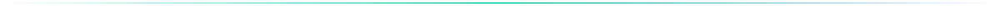
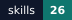
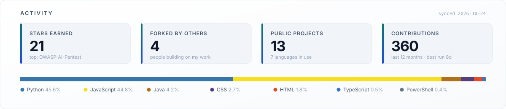

<picture>
  <source media="(prefers-color-scheme: dark)" srcset="assets/hero-dark.svg" />
  
</picture>

  I find the ways systems break, then build the tooling and hardened infrastructure that keep them from breaking again. 
  Currently focused on <strong>AI/LLM infrastructure</strong> with security designed in from the first commit.

  &nbsp;
  &nbsp;
  &nbsp;
  

  <strong>NEW &middot;</strong> <a href="https://github.com/noahfranklin/gideon">Gideon</a> — a 26-skill offensive &amp; defensive security suite for Claude Code &amp; Codex. &nbsp;⭐ Star it &middot; <a href="https://github.com/noahfranklin?tab=followers">Follow</a> for offensive-security tooling &amp; AI-security research.

## About

<table>
<tr>
<td width="33%" valign="top">

**Offensive security**

Web application pentesting, exploit development, and red-team assessments grounded in the OWASP Top 10 and CWE Top 25.

</td>
<td width="33%" valign="top">

**Secure engineering**

Full-stack systems in Python, TypeScript, and JavaScript. Threat-modelled before the first line, tested and observable from day one.

</td>
<td width="33%" valign="top">

**AI/LLM infrastructure**

Provider-agnostic LLM proxies, offline admin tooling, and security research on AI-powered applications.

</td>
</tr>
</table>

## Featured work

<table>
<tr>
<td width="50%" valign="top">

### [🛡️ Gideon](https://github.com/noahfranklin/gideon)

A complete offensive **and** defensive security suite for Claude Code & Codex — **26 authorization-first Agent Skills** across web, API, mobile, AI/LLM (agents, tool-use & MCP), network, cloud, containers, IoT, Active Directory & Entra ID, and the CI/CD supply chain, plus exploit-chaining, detection engineering, and report writing. Standards-mapped end to end.

  

</td>
<td width="50%" valign="top">

### [OWASP-AI-Pentest](https://github.com/noahfranklin/OWASP-AI-Pentest)

A guided walkthrough for standing up and pentesting AI-powered applications locally, from environment setup through attack-surface analysis.

  

</td>
</tr>
<tr>
<td width="50%" valign="top">

### [OWASP-TimeMachine](https://github.com/noahfranklin/OWASP-TimeMachine)

An interactive lab for learning web application pentesting. Work through the OWASP Top 10 hands-on, one vulnerability class at a time, in a safe, self-contained environment.

  

</td>
<td width="50%" valign="top">

### [free-claude-code](https://github.com/noahfranklin/free-claude-code)

A hardened proxy that routes Claude Code and Codex traffic to any provider — free, paid, or local. Offline admin dashboard, stream idle-timeout watchdog, clean auth errors, and a health-checked model picker.

  

</td>
</tr>
</table>

## Latest commits

Pulled from my most recently pushed public repos every six hours.

<!--RECENT_REPOS:START-->
<table>
<tr>
<td><a href="https://github.com/noahfranklin/gideon/commit/05b9ba96f5405fe942dee6870243815f7d5a971f"><code>05b9ba9</code></a></td>
<td><a href="https://github.com/noahfranklin/gideon"><strong>gideon</strong></a></td>
<td>README: refresh prose + standards mapping for the 26-skill suite</td>
<td>6 days ago</td>
</tr>
<tr>
<td><a href="https://github.com/noahfranklin/gideon/commit/dfe53492a7481872ea8021b045ef9061bf04ca4d"><code>dfe5349</code></a></td>
<td><a href="https://github.com/noahfranklin/gideon"><strong>gideon</strong></a></td>
<td>Gap review: +5 skills (21→26) and latest-method refreshes</td>
<td>6 days ago</td>
</tr>
<tr>
<td><a href="https://github.com/noahfranklin/gideon/commit/e53b10649eb7796829724a3d1aa8a2eeef35ab1e"><code>e53b106</code></a></td>
<td><a href="https://github.com/noahfranklin/gideon"><strong>gideon</strong></a></td>
<td>Assert sole authorship &amp; copyright (noahfranklin)</td>
<td>27 days ago</td>
</tr>
<tr>
<td><a href="https://github.com/noahfranklin/gideon/commit/4359a77a6e7d7273d4bcc5a676f6733bc0a2fe53"><code>4359a77</code></a></td>
<td><a href="https://github.com/noahfranklin/gideon"><strong>gideon</strong></a></td>
<td>docs: warm &quot;torch &amp; parchment&quot; re-skin + animated demo, walkthroughs, c…</td>
<td>28 days ago</td>
</tr>
<tr>
<td><a href="https://github.com/noahfranklin/gideon/commit/2960d156ae7fdf2860d362d74980e16958c02bbd"><code>2960d15</code></a></td>
<td><a href="https://github.com/noahfranklin/gideon"><strong>gideon</strong></a></td>
<td>docs: add architecture + workflow diagrams and guides</td>
<td>28 days ago</td>
</tr>
<tr>
<td><a href="https://github.com/noahfranklin/gideon/commit/1367334cd88c346e1fdf5acb3eff713f849bb338"><code>1367334</code></a></td>
<td><a href="https://github.com/noahfranklin/gideon"><strong>gideon</strong></a></td>
<td>README: add orchestration diagram + example prompts; add skills.json ca…</td>
<td>28 days ago</td>
</tr>
</table>

Last synced 2026-10-25
<!--RECENT_REPOS:END-->

## Stack

<table>
<tr>
<td valign="middle"><strong>Languages</strong></td>
<td>

</td>
</tr>
<tr>
<td valign="middle"><strong>Security</strong></td>
<td>

</td>
</tr>
<tr>
<td valign="middle"><strong>Platform</strong></td>
<td>

</td>
</tr>
</table>

## Activity

Rendered by my own generator from the GitHub API every six hours.

<picture>
  <source media="(prefers-color-scheme: dark)" srcset="assets/generated/metrics-dark.svg" />
  
</picture>

  <!-- Rendered by .github/workflows/snake.yml into the `output` branch -->
  <picture>
    <source media="(prefers-color-scheme: dark)" srcset="https://raw.githubusercontent.com/noahfranklin/noahfranklin/output/github-contribution-grid-snake-dark.svg" />
    
  </picture>

## Capture the flag

There is a signal hidden in the radar at the top of this page. Not everything on a radar is visible.

Decode it, recover the flag, then [open a CTF issue](https://github.com/noahfranklin/noahfranklin/issues/new?template=ctf.yml) with `sha256(flag + ":" + your_github_login)`. A bot checks it and adds you below. Never post the flag itself.

**Hall of fame**

<!--CTF_HOF:START-->
_Nobody yet. Be the first._
<!--CTF_HOF:END-->

## Contact

Open to security engineering, red-team, and AI infrastructure work. The fastest way to reach me is a message on <a href="https://x.com/iamnoahfranklin">X</a> or <a href="https://www.linkedin.com/in/iamnoahfranklin">LinkedIn</a>.

  The best way to defend a system is to know exactly how you would break it.

